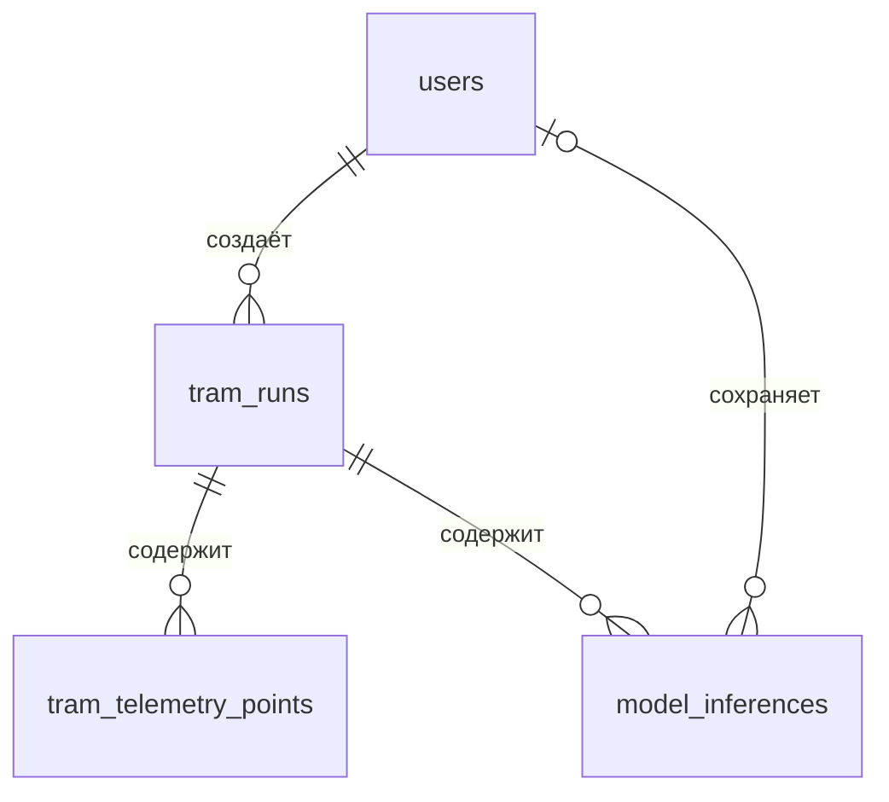

# Соответствие TramWebApp лабораторным работам 2 3 и 4

Проверено по трём предоставленным заданиям, исходному коду и работающим экземплярам приложения. Сопоставление относится к трамвайной предметной области: основная CRUD-сущность — прогон. В ЛР2 перечислены альтернативные варианты приложений; конкретного трамвайного варианта в документе нет, поэтому проверены общие технические требования и аналогичные операции над прогонами.

Основные возможности уже были реализованы. При аудите исправлены исключение из чистой архитектуры в тренажёре, доступность и описание Swagger, неполное разграничение доступа, фактически не вызывавшиеся валидаторы, ошибки связей в памяти и сохранения корректировок. Добавлены воспроизводимая генерация тестового набора и отдельный запуск ЛР2 без PostgreSQL.

## Лабораторная работа 2

| Требование задания | До аудита | Сейчас и где проверять |
|---|---|---|
| Чистая или луковая архитектура | Четыре проекта существовали; SimulationController выполнял SQL-запросы и содержал сценарий движения | Контроллер использует ISimulationUseCases; сценарий находится в Application, расчёт динамики — в Domain, EF и хранение — в Infrastructure. Program остаётся точкой сборки DI |
| CRUD web-сервис | Реализован для прогонов | GET `/api/tram-runs`, GET `/api/tram-runs/{id}`, POST `/api/tram-runs`, PUT и DELETE `/api/tram-runs/{id}` |
| Методы GET POST PUT DELETE | Реализованы | Проверены через HTTP и интерфейс; DELETE доступен администратору |
| REST | Ресурсные URL и JSON уже существовали | Статус 201 и Location при создании, 204 при удалении, 400 при неверном вводе, 401/403 при отказе в доступе, 404 для отсутствующего ресурса, 409 для конфликта. JWT передаётся в каждом запросе |
| Swagger UI и описание API | Был код Swagger, но в Production/Docker он не открывался; описания и авторизация были неполными | Открываются [Swagger UI](http://localhost/swagger/index.html) и [OpenAPI JSON](http://localhost/swagger/v1/swagger.json). Методы имеют описания, схемы запросов/ответов и требования JWT |
| Демонстрация запросов в браузере | React-клиент был | React и Swagger проверены браузерными сценариями; в Swagger можно отправить запросы и увидеть код и тело ответа |
| Хранение в памяти, лимит 50 записей | Лимит 50 прогонов существовал; счётчики дочерних записей обновлялись не везде, удаление оставляло связанные данные | Отдельный InMemory-режим без PostgreSQL. Максимум 50 основных CRUD-записей — прогонов; 51-й отклоняется с 409. Телеметрия и результаты являются дочерними записями. Счётчики и каскадное удаление исправлены |
| Страницы создания удаления просмотра и навигация | Уже реализованы | «Прогоны»: создание, редактирование, удаление администратором, поиск и переход к подробностям. Навигация между прогонами, моделью, тренажёром и историей |
| Интерактивность | Уже реализована | Формы, проверка ввода, уведомления, вкладки, пагинация, воспроизведение, редактор сигналов и тренажёр |

Ограничение 50 относится к прогонам, а не к сумме всех пользователей, точек и результатов. Это выбранный аналог ограничения на книги/новости/товары из вариантов задания. Проверка лимита выполняется на изолированном сервере, не затрагивая рабочую PostgreSQL.

## Лабораторная работа 3

| Требование задания | До аудита | Сейчас и где проверять |
|---|---|---|
| PostgreSQL вместо памяти | Реализовано | Основной Docker Compose использует PostgreSQL 16 и постоянный volume |
| Проектирование БД | Реализовано | Таблицы users, tram_runs, tram_telemetry_points, model_inferences; первичные ключи, внешние ключи, уникальные ограничения, индексы. Маршрут хранится в JSONB |
| Entity Framework Core | Реализовано | TramDbContext, Npgsql и EF Core 8.0.8 в Infrastructure |
| LINQ и IQueryable | Реализовано | Репозитории строят Where/OrderBy/Include над DbSet/IQueryable, затем выполняют FirstOrDefaultAsync/ToListAsync/CountAsync. IQueryable не передаётся в Domain и HTTP-контроллеры |
| Fluent API | Реализовано | Папка `src/TramWebApp.Infrastructure/Configurations` описывает столбцы, ограничения и связи |
| Code-first и миграции | Реализовано | Папка Migrations; миграции автоматически применяются при старте. Данные при обновлении не сбрасываются |
| DI | Реализовано, но тренажёр получал сервисы через IServiceProvider | Контроллеры получают интерфейсы через конструкторы. DI выбирает PostgreSQL- или InMemory-репозиторий тренажёра |
| Манипуляции с БД в репозиториях | Частично: тренажёр работал с DbContext в контроллере | SimulationRepository содержит выборку последней точки и атомарную запись шага. В контроллерах и Application нет EF/DbContext |
| Тестовые данные и скрипт генерации | Был автоматический C# seed, отдельного скрипта для текущего API не было | [generate-test-data.ps1](scripts/generate-test-data.ps1) создаёт воспроизводимые учебные прогоны, телеметрию и результаты через API. Поддерживает RandomSeed и Cleanup |
| Docker-образ и развертывание | Реализовано | Dockerfile для API и frontend; проверяется сборка и запуск контейнеров |
| Собственный Docker Compose и зависимые сервисы | Реализовано | [docker-compose.yml](docker-compose.yml): API, React/nginx, PostgreSQL и pgAdmin |
| Аутентификация API | Реализована | JWT, вход, регистрация, профиль, хэширование паролей BCrypt |
| Роли admin пользователь анонимный — опционально | Частично: проверки основного прогона существовали, дочерние данные защищались не полностью | Пользователь читает и меняет собственные прогоны и их данные. Администратор имеет доступ ко всем прогонам и удалению. Без JWT защищённые методы возвращают 401; чужие данные — 403. Проверки вынесены в RunAccess |

Скрипт `D:/WebTRAMV/seed.py` относится к Python-модулям `app.domain` и `app.infrastructure.memory_repo`; текущий .NET-сервис его не вызывает. Для этой версии приложения используются C# SeedData и новый PowerShell-скрипт.

### Схема связей



Удаление прогона удаляет его точки и результаты. Удаление пользователя с созданными прогонами ограничено внешним ключом; ссылка на пользователя в результатах может становиться NULL. Для пар `(tram_run_id, sequence_number)` действует уникальность.

## Лабораторная работа 4

| Требование задания | Реализация |
|---|---|
| FE на React Angular или Vue | React 18 + TypeScript + Vite |
| Два приложения: REST backend и отдельный клиент | ASP.NET Core API и React/nginx — разные проекты и контейнеры, API на 8080, клиент на 80 |
| Получение данных через HTTP REST | ApiService использует Axios для запросов авторизации, прогонов, телеметрии, модели, истории и тренажёра |
| Отображение данных | Список и подробности прогонов, таблицы телеметрии и истории, графики, схема/карта и показатели движения |
| Манипуляции данными | Создание/редактирование/удаление прогонов, сохранение результата и корректировки; тренажёр записывает новые точки и результаты |
| Взаимодействие с пользователем | Формы, навигация, поиск, пагинация, уведомления, восстановление после ошибки API, воспроизведение и ручка |

ЛР4 не требует дополнительных сущностей магазина, обязательного конкретного CSS-фреймворка или обучения ML-модели. Дополнительный функционал трамвая проверен как часть существующего приложения.

## Что показать при сдаче

### ЛР2 без PostgreSQL

```powershell
cd D:\WebTRAMV\TramWebApp
docker compose -p tramwebapp-lab2 -f docker-compose.lab2.yml up --build -d
```

Клиент: http://localhost:8082. API и Swagger: http://localhost:8081/swagger/index.html. В интерфейсе отображается предупреждение о хранении в памяти. После перезапуска API эти данные исчезают. Рабочая PostgreSQL основного приложения остаётся отдельной.

### ЛР3 и ЛР4 с PostgreSQL

```powershell
cd D:\WebTRAMV\TramWebApp
docker compose up --build -d
powershell -NoProfile -ExecutionPolicy Bypass -File .\scripts\generate-test-data.ps1 -Runs 2 -Steps 25
```

Клиент: http://localhost. API: http://localhost:8080. Swagger доступен также через http://localhost/swagger/index.html. Вход администратора: admin / admin123; пользователя: operator / user123. Генератор печатает ссылки на созданные записи. С параметром `-Cleanup` удаляются только прогоны, созданные этим запуском скрипта.

В браузере покажите вход, список прогонов, создание и изменение, телеметрию, удаление тестового прогона; в Swagger — те же HTTP-методы, JSON и ответы. Для ЛР3 дополнительно покажите таблицы в pgAdmin, миграции и реализацию LINQ/Fluent API в Infrastructure. Не удаляйте Docker volume для этой демонстрации.

## Проверки

Сценарии находятся в [experience.spec.ts](frontend/tests/experience.spec.ts), [labs.spec.ts](frontend/tests/labs.spec.ts) и [smoke-test.ps1](smoke-test.ps1). Лимит памяти проверяется только при явном `TEST_STORAGE_MODE=InMemory` на отдельном сервере. Это исключает заполнение рабочей PostgreSQL тестовыми записями.

Итог проверки 15 октября 2026 года: основной PostgreSQL-режим — 11 сценариев прошли, 1 проверка лимита памяти пропущена по назначению; отдельный React/API-стек InMemory — все 12 сценариев прошли, включая лимит 50. API smoke-проверка прошла в обоих режимах. Генератор создал 4 точки и 4 результата, проверил их количество через API и удалил только собственный тестовый прогон. Сборки .NET и frontend, ESLint и `git diff --check` прошли. Эти проверки подтверждают перечисленные сценарии, а не отсутствие любых возможных дефектов.

```powershell
cd D:\WebTRAMV\TramWebApp\frontend
$env:TEST_BASE_URL = 'http://localhost'
npx playwright test

# Проверка того же клиента в режиме ЛР2:
$env:TEST_BASE_URL = 'http://localhost:8082'
$env:TEST_STORAGE_MODE = 'InMemory'
npx playwright test
```

Модель оценки скорости остаётся демонстрационной `1.0.0-mock`; файл `ml_model.yaml` не подключён. Тренажёр использует отдельную учебную динамику. Обученная ML-модель, калибровка зимнего торможения и интеграция с реальным вагоном не являются требованиями предоставленных ЛР2–ЛР4 и в этом аудите не подменяются имитацией.

Источники требований: предоставленные файлы «Задание на лабораторную работу 2.docx», «Задание на лабораторную работу 3.docx», «Задание на лабораторную работу 4.docx» из `C:/Users/apollo/Downloads/Telegram Desktop`.
